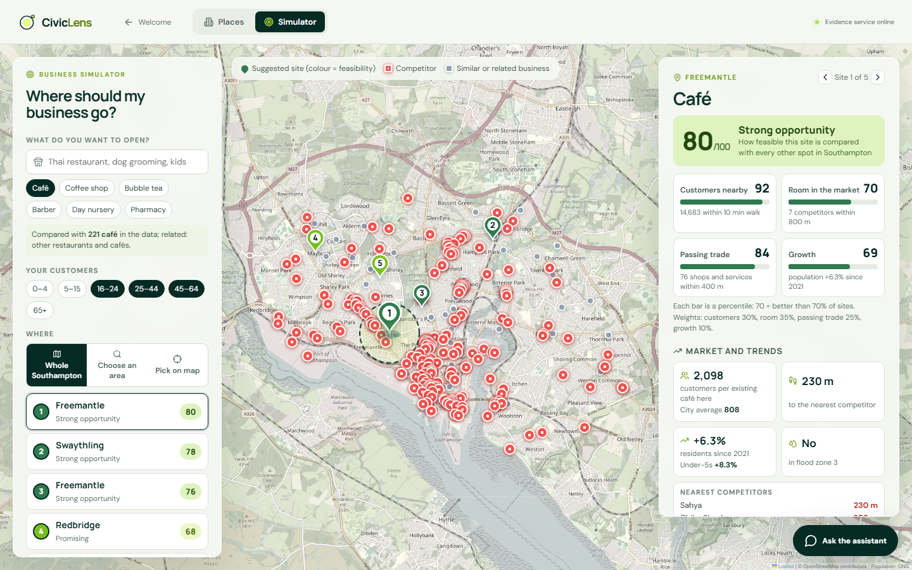
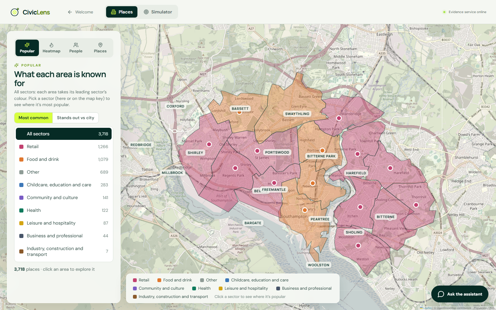
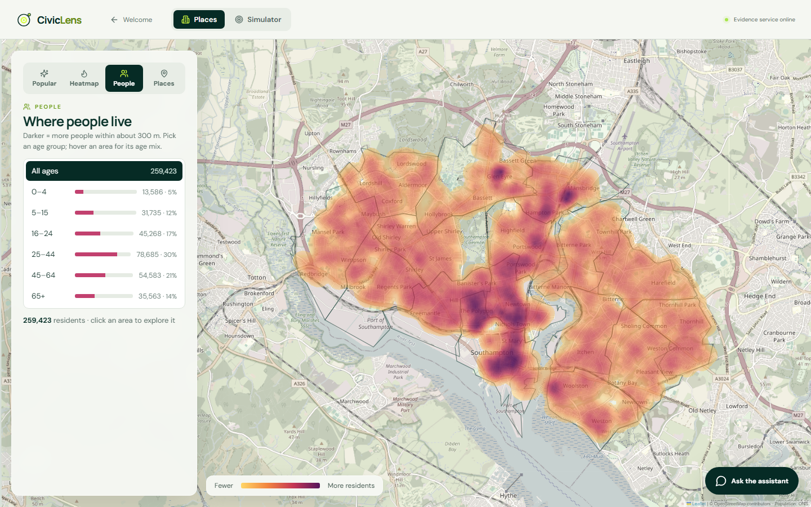
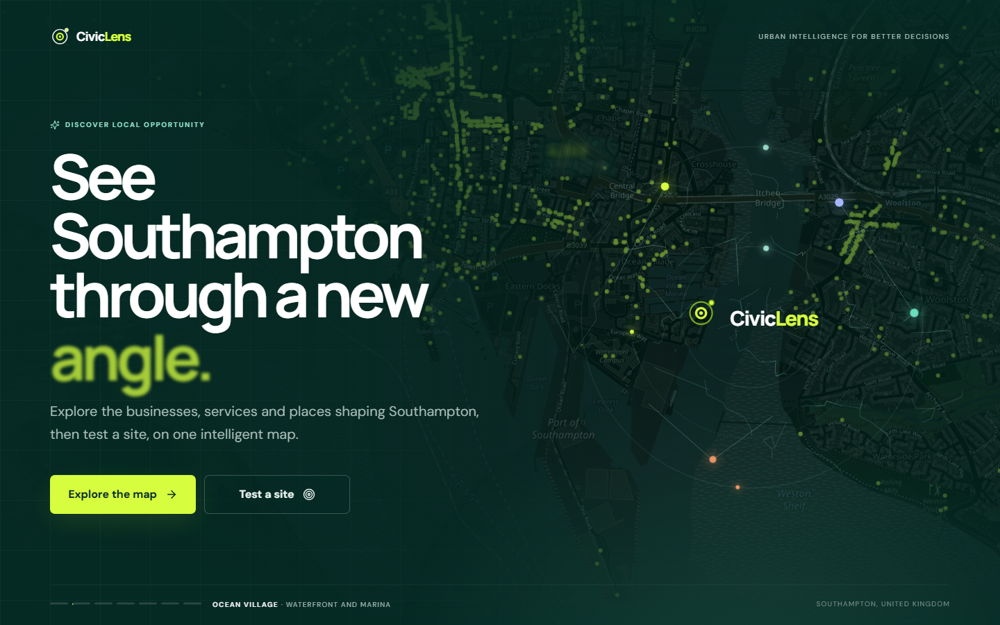
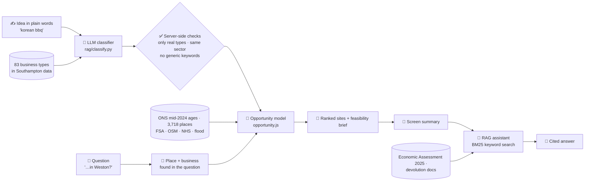
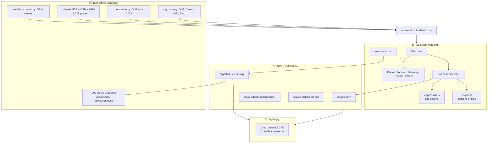
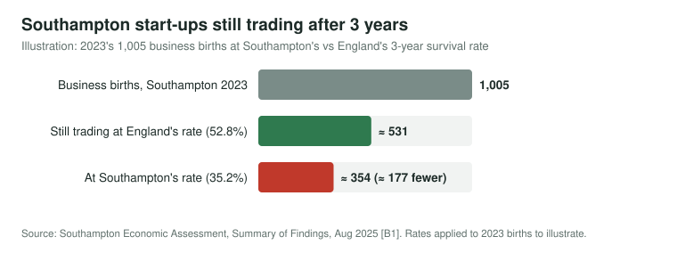
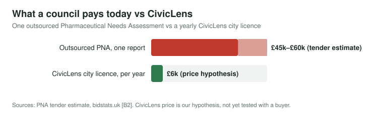
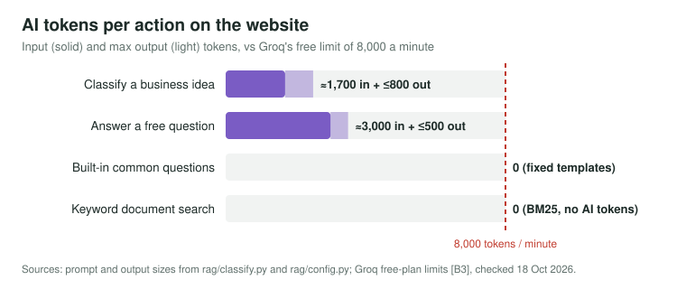
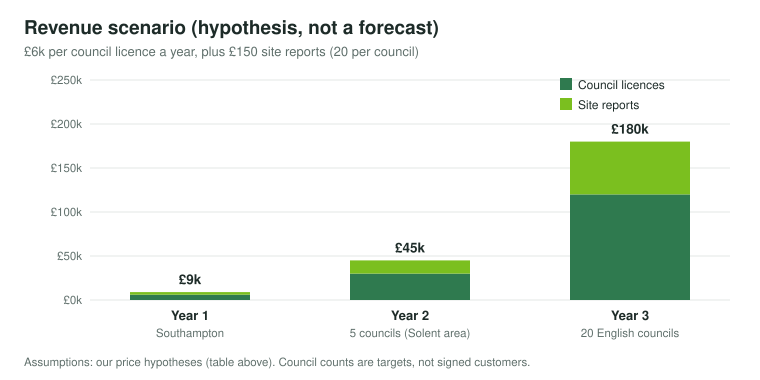

<p align="center">
  
</p>

<p align="center"><b>Type any business idea. See where in Southampton it would work, and why.</b></p>

<p align="center">
  
  
  
  
  
  
  
</p>

<p align="center">
  🌐 <b>Live site:</b> <a href="https://civiclens-sotonship2026.onrender.com">civiclens-sotonship2026.onrender.com</a> · 🎬 <b>Demo video:</b> <a href="https://youtu.be/139KMawz2Dw">youtu.be/139KMawz2Dw</a> · 🛠️ <a href="#️-run-it-yourself">Run it yourself</a>
</p>

## 🎬 Demo video

<p align="center">
  <a href="https://youtu.be/139KMawz2Dw" title="Watch the CivicLens demo on YouTube">
    
  </a>
  <br><sub>▶️ Click to play the demo on YouTube</sub>
</p>

| 🧠 Understands any idea | 🗺️ Scores every street | 💬 Explains with evidence |
|---|---|---|
| "Korean BBQ", "dog grooming", "craft beer bar": an LLM maps free text onto the real business types in Southampton's data, including its niche, competitors and customers | 792 small areas scored on customers by age, room in the market, passing trade and population growth, from real ONS, FSA, NHS and OpenStreetMap data | An assistant that sees what is on screen, answers about the area you name, and links every citation to the page of Southampton's own report it came from |

# 🔍 CivicLens: _see what Southampton needs, and where_

> **CivicLens helps people starting a small business in Southampton, and the council teams who advise them, decide where to open.** You type the business in your own words. A language model (Qwen3.8 27B through Groq's API) classifies it against the 83 business types that actually exist in the city's data (e.g. "sushi bar" → Japanese, with Chinese and Thai as similar cuisines). A deterministic model then scores every one of Southampton's 792 Output Areas on target customers by age (ONS mid-2024), competitors and similar businesses (3,718 real places from the Food Standards Agency register, OpenStreetMap and the NHS), passing trade and growth, and proposes the best sites with a plain-language feasibility brief. An assistant grounded in Southampton's Economic Assessment answers follow-up questions and cites its sources. For public services (nursery, GP, pharmacy, café, library) a planning engine adds walking-distance coverage, deprivation reach, flood risk and a planning brief whose every number is automatically checked.

<details open>
<summary><b>📑 Contents</b> (click to collapse)</summary>

- [🎬 Demo video](#-demo-video)
- [📖 The story](#-the-story)
- [🎯 The problem](#-the-problem)
- [🧭 Judges: a 2-minute tour](#-judges-a-2-minute-tour)
- [🖼️ What it looks like](#️-what-it-looks-like)
- [⚙️ How it works: AI at the core](#️-how-it-works-ai-at-the-core)
- [🏗️ Architecture](#️-architecture)
- [📊 Measured results](#-measured-results)
- [🗂️ Data sources (with dates and licences)](#️-data-sources-with-dates-and-licences)
- [💼 Business and scale](#-business-and-scale)
- [🛡️ Responsibility and trust](#️-responsibility-and-trust)
- [🎯 How CivicLens meets each judging criterion](#-how-civiclens-meets-each-judging-criterion)
- [📝 Project summary](#-project-summary)
- [🙏 Credits and AI use](#-credits-and-ai-use)
- [🛠️ Run it yourself](#️-run-it-yourself)
- [🚧 Known limits](#-known-limits)
- [🔭 Future work](#-future-work)
- [❓ Questions and answers](#-questions-and-answers)

</details>

---

## 📖 The story

### 💭 Who decides where a new business goes?

Usually one person, with a spreadsheet, a few walks round the area and a gut feeling. Someone who wants to open a Korean restaurant has to work out alone how many people of the right age live nearby, how many Korean, Chinese or Thai places are already there, whether the street gets passing trade, and whether the area is growing. The data to answer each question exists and is open, but it sits in five different places, in formats only an analyst can join.

### ✋ Use AI to understand the idea, and open data to judge the place

CivicLens does not ask an AI where to open a shop. That would produce confident guesses. It uses AI for the part that genuinely needs language understanding, **turning "a little sushi bar for students" into the data's own categories**, and it leaves every number to a deterministic, tested model built on official data.

> 🎬 **Picture this.** Mina wants to open a Korean BBQ. She types it in and presses Enter. In a few seconds CivicLens shows five sites across the city, best first. It has found all 5 Korean restaurants in Southampton and the Chinese, Thai and Japanese places that compete for the same diners. It explains that Freemantle has 11,168 people aged 16–64 within a 10-minute walk and no Korean place within 800 m, and that the population there grew 7.3% since 2021. She asks the assistant *"what about Portswood?"* and gets Portswood's own figures, with sources. _(Illustrative user; the numbers are real outputs from the current data.)_

---

## 🎯 The problem

### We help **people starting a small business** to **decide where to open** in **Southampton's neighbourhoods** using **an LLM that understands any business idea, and a site model built on ONS, FSA, NHS and OpenStreetMap data**.

**How might we** give a first-time business owner the same site analysis a retail chain buys from consultants, in under a minute, for free?

### 📉 Local evidence that this matters in Southampton

All figures from the Southampton Economic Assessment, Summary of Findings, August 2025 ([Southampton Data Observatory](https://data.southampton.gov.uk/media/iqgh14rf/economic-assessment-august-2025.pdf)), which is also indexed in the assistant.

| 📉 **35.2%** | 🧱 **421 vs 653** | 🐣 **-29.5%** | 🛍️ **-155** |
|---|---|---|---|
| of Southampton businesses survive 3 years, against **52.8%** in England (5-year: 33.1% vs 39.4%) | businesses per 10,000 working-age residents, Southampton vs England | fall in business start-ups in 2023 (1,005 births, 420 fewer than 2022) | retail enterprises lost in one year, the largest fall of any sector (total enterprises -2.8%) |

The Assessment flags multiple-registration effects on some of these figures; the gap with England is still wide. A poor location is one of the few causes of failure that can be checked **before** money is spent.

### What people do today

| Option | Good at | Falls short |
|---|---|---|
| Walk the area, ask around | Local feel | No numbers on customers, competition or growth; slow |
| Spreadsheet of nearby competitors | Cheap | Misses similar businesses, ignores who lives nearby; "fewest competitors" picks empty places (see [baseline](#-measured-results)) |
| Consultant site report | Thorough | Hundreds to thousands of pounds per site; out of reach for a sole trader |
| Generic AI chatbot | Fast, friendly | Doesn't know Southampton's streets; invents numbers |
| **CivicLens** | **Any idea, every street, real dated data, cited answers** | Straight-line distance, no rents or vacancies yet ([limits](#-known-limits)) |

### Who it is for

- 🧑‍🍳 **Main user: someone opening a small business in Southampton** (a café, takeaway, salon, studio).
- 🏛️ **Southampton City Council teams** who advise new businesses or plan services. The planning engine answers "where should the next nursery, GP, pharmacy, café or library go?" for the statutory Pharmaceutical Needs Assessment and Childcare Sufficiency Assessment.
- 🏢 **Small chains** looking for their next site.

---

## 🧭 Judges: a 2-minute tour

| # | Do this | What you'll see |
|---|---|---|
| 1 | Open the site → **Business simulator** | Café is analysed at first load: five ranked pins coloured by feasibility, competitors as coral dots |
| 2 | Type **`korean bbq`** in "What do you want to open?" and press **Enter** | In about a second: sites re-ranked for Korean BBQ, the 5 real Korean restaurants as competitors, similar cuisines on the map |
| 3 | Click pin **1**, hover any dot | Feasibility score, four factor bars, market trends, who benefits by age group, strengths, risks, suggested changes, limitations; hover card with name, type and walking distance |
| 4 | Open **Ask the assistant** → pick a common question, or ask *"I want to open a Japanese store in Weston"* | Common questions answer instantly from the figures on screen. Free questions get an answer about **Weston** (not the site on screen), citing `[App analysis]` and the Economic Assessment; click a citation to open the source document at that page |
| 5 | Go to **Places** → **Popular** → click **Food and drink**, then **People** | Every sector has its colour; areas shade by how popular a sector is; residents by age group on a heat map |
| 6 | Read the **right-hand panel** for the open site | The AI's reading of your idea applied to the data: the niche it found, which businesses compete like-for-like and which are similar, the customer age groups it chose (the age mix shows what share of nearby residents they are), how much the idea relies on passing trade (this sets the factor weights), its reasoning and setup tips. Try **`dog grooming`**: nothing like it exists in the data, so it shows a *possible gap in the market* instead of inventing competitors |

---

## 🖼️ What it looks like

<table>
<tr>
<td width="50%"><br><sub><b>Business simulator.</b> Ranked sites, competitors, factor bars and the feasibility brief.</sub></td>
<td width="50%"><br><sub><b>Places, Popular.</b> 3,718 real places; click a sector to shade where it is popular.</sub></td>
</tr>
<tr>
<td><br><sub><b>Places, People.</b> Where residents live (ONS mid-2024), by age group.</sub></td>
<td><br><sub><b>Welcome.</b> Entry point to the two tools and the assistant.</sub></td>
</tr>
</table>

---

## ⚙️ How it works: AI at the core

> **The AI decides what to compare; the model counts.** The LLM reads the idea and decides which businesses compete, who the customers are and how much passing trade matters. Deterministic code then turns those decisions into every score, count and percentage from dated open data, so each number can be traced and re-computed.



### 1. The LLM classifies the idea against the city's own categories

`POST /api/classify` ([rag/classify.py](rag/classify.py)) gives the model the idea plus the sectors and business types that exist in the data, and asks for JSON: business, sector, niche, **like-for-like types**, **similar types** (another niche of the same kind, e.g. other cuisines), related types, name keywords (e.g. *korean, bulgogi*), customers by age group, how much it relies on passing trade, reasoning and setup tips. The server then enforces the rules:

- only types that exist are kept; vague "cuisine not known" types can never be like-for-like;
- like-for-like is the closest niche (at most two); extra ones become "similar";
- when the model's sector label disagrees with the types it chose, the types win;
- generic name words (*food, club, shop*) are dropped.

**What if you removed the AI?** The page's fallback, a keyword matcher, maps *sushi bar* to a hairdresser, *curry house* to a hotel and *vietnamese pho place* to a mobile phone shop. On 22 labelled ideas it gets **9** right; the LLM gets **21** ([results](#-measured-results)).

### 2. A deterministic model scores every site

[frontend/src/simulator/opportunity.js](frontend/src/simulator/opportunity.js) scores the centre of each of the 792 Output Areas:

| Factor | Measure | Data |
|---|---|---|
| **Customers nearby** | Target-age residents within walking distance (default 800 m), nearer people counting more | ONS mid-2024 small area estimates by age |
| **Room in the market** | Customers ÷ (1 + 2 × like-for-like + 0.6 × similar + 0.3 × related), see below | 3,718 places (FSA, OSM, NHS) |
| **Passing trade** | Customer-facing places within 400 m | Same |
| **Growth** | Population change since Census 2021 | Census 2021 vs ONS mid-2024 |

<details>
<summary><b>📐 Room in the market: the calculation and where it comes from</b></summary>

For a candidate site *s* with walking radius *R* (800 m by default), every resident area *j* and every business *k* within *R* is weighted by distance *d*:

```text
distance weight   g(d) = 1 − 0.5 × d / R           (1 at the door, 0.5 at the edge, 0 beyond R)
customers  D(s)  = Σ_j  target-age residents_j × g(d_sj)
competition C(s) = 2 × Σ_like-for-like g(d) + 0.6 × Σ_similar g(d) + 0.3 × Σ_related g(d)
room in the market  Room(s) = D(s) / (1 + C(s))
```

- **Why a ratio of customers to competitors.** It is the supply-to-demand ratio used in the two-step floating catchment area method for measuring access to services within a catchment (Luo and Wang, 2003 [M1]): demand inside a catchment divided by the supply competing for it. The `1 +` keeps the score finite where there are no competitors.
- **Why nearer customers and competitors count more.** Spatial-interaction models of retail trade areas weight shoppers by distance, because the chance of using a store falls as distance grows (Huff, 1964 [M2]). We use a simple linear decay inside a walking catchment rather than a fitted model.
- **Why different weights for competitors.** A like-for-like business (another Korean restaurant) competes fully, a similar one (another cuisine) partly, a related one (any restaurant) a little. The weights 2 / 0.6 / 0.3, the 50% decay and the 800 m default are **our design choices**, set in [opportunity.js](frontend/src/simulator/opportunity.js); they are not fitted to outcomes yet ([known limits](#-known-limits)).
- **From raw value to score.** Room, like the other factors, becomes a percentile against all 792 sites, so 70 means better than 70% of Southampton.

**References.** [M1] Luo, W. and Wang, F. (2003). Measures of spatial accessibility to health care in a GIS environment: synthesis and a case study in the Chicago region. *Environment and Planning B: Planning and Design*, 30(6), 865–884. · [M2] Huff, D. L. (1964). Defining and estimating a trading area. *Journal of Marketing*, 28(3), 34–38.

</details>

Each factor becomes a percentile against every site in the city, weighted by how much the business relies on passing trade (from the classifier), minus 15 points in Flood Zone 3. If no like-for-like business exists anywhere, the business is treated as a **possible gap in the market**: the factor becomes "Stands out", and nearby similar businesses count as proven demand (1–4) or crowding (5+).

### 3. The assistant explains what is on screen, for the place you ask about

The chat ([rag/](rag/)) is a retrieval-augmented assistant: **keyword search** (BM25) finds the most relevant passages in Southampton's documents, then **the AI** (Qwen3.8 27B on Groq) reads them and writes a grounded, cited answer. With every question the page sends a summary of what is on screen. If the question names one of 16 wards or 75 neighbourhoods (from OpenStreetMap), the page first runs the model for **that** place and business.

- **Built-in common questions are answered deterministically** ([rag/templates.py](rag/templates.py)): "how many competitors are near this site?", "which areas have the most businesses?" and the rest are filled straight from the on-screen figures or a fixed page of the evidence PDF, with no LLM call, so the same screen always gives the same answer.
- **Free questions go to the LLM** with a prompt that limits citations to the retrieved documents and `[App analysis]`, asks for a one-sentence conclusion plus at most three bullets, checks that increases and decreases are described the right way round, and allows labelled *"General guidance (not from Southampton evidence)"* only where the documents stop.
- **Every citation is a link**: `GET /api/evidence/…` opens the source document at the cited PDF page, and only files inside `data/raw/` can be served.
- **History is used only for real follow-ups** ("what about there?", "which one…"); a new, self-contained question is not mixed with the previous topic.

<details>
<summary><b>🧠 Model choices and why</b></summary>

| Job | Model | Why |
|---|---|---|
| Classify business ideas (`/api/classify`) | **Qwen3.8 27B** on **Groq** (`qwen/qwen3.8-27b`, reasoning off) | Fast (about 1 s), free tier for the demo, JSON mode for structured output; 21/22 on our benchmark |
| Document search and answers (`/api/chat`) | **Keyword search (BM25) + Qwen3.8 27B on Groq** | Keyword search finds the passages (13/14 in the top 3 on our test set); the AI reads them and writes the cited answer |
| Site scoring, coverage, optimiser, planning brief | **No AI** (deterministic code, audited template) | Numbers must be reproducible and testable |

</details>

<details>
<summary><b>🏛️ The planning engine for public services (Module C)</b></summary>

For a nursery, GP, pharmacy, café or library, [simulator/engine.py](simulator/engine.py) (mirrored in the browser by `viewer/src/engine.js`) computes before-and-after walking-distance coverage, who newly gains access by deprivation quintile, competition, diversity, jobs (assumption table), flood constraint, separate **community need** and **commercial viability** scores, a sensitivity check, and a greedy optimiser proven equal to exhaustive search over all 792 sites. The planning brief is written from a fixed template filled with the engine's results, and **every number in it is extracted and checked against the data** before it is shown. Thin evidence (fewer than 5 existing sites) gets a rule-based refusal. Full method: [docs/SIMULATOR.md](docs/SIMULATOR.md).

</details>

---

## 🏗️ Architecture

> **Are there AI agents?** No. Two single-purpose LLM calls (classify, answer), each with server-side validation, around deterministic code.



| Stage | Module | What happens | On failure |
|---|---|---|---|
| Data build | `pipeline/` → `python run.py places`, `population`, `city-data`, then `viewers` | Downloads, cleans, merges, flags and dates every source; writes JSON for the app | A failed source is skipped and the others still build; `--osm-file` / `--fsa-file` / `--offline` reuse saved copies |
| Classify | `rag/classify.py` | LLM → JSON → validated against real types | Page falls back to keyword matching and keeps working |
| Score | `frontend/src/simulator/opportunity.js` | Percentile scores, ranked sites ≥1 km apart, feasibility brief | Pure functions; no network |
| Explain | `rag/templates.py`, `rag/generator.py`, `rag/retriever.py` | Common questions: fixed answers from on-screen figures. Free questions: keyword retrieval, grounded prompt with allowed citations, linked sources | Error message in the chat; the rest of the app is unaffected |
| Plan (public services) | `viewer/src/engine.js` (port of `simulator/engine.py`) | Coverage, equity, optimiser; template brief with every number audited | Thin evidence (under 5 sites) gets a refusal instead of a brief |

<details>
<summary><b>🗺️ Repo map</b></summary>

| Path | What it is |
|---|---|
| `run.py` | One entry point: `python run.py` lists every command |
| `frontend/` | React 19 + Vite + react-leaflet app: Places, Business simulator, assistant |
| `rag/` | FastAPI API, classifier, RAG (documents, embeddings, retriever, generator, deterministic answer templates), Groq client |
| `simulator/` | Planning engine (no AI), brief audit, config, paths |
| `pipeline/` | Data builders: `city_data.py`, `population.py`, `neighbourhoods.py`, `places/` |
| `viewer/` | Self-contained HTML pages (simulator, places register) and the data packer for the React app |
| `data/` | `raw/` (sources + `SOURCES.json` + RAG documents), `processed/`, `db/` (places database) |
| `tests/` | pytest: engine, places merge, classifier, assistant templates and follow-ups, AI clients |
| `evaluation/` | Baseline comparison, classifier benchmark, live-brief runner, `results/` |
| `docs/` | [CODEBASE.md](docs/CODEBASE.md) (every file, "where to change what"), [SIMULATOR.md](docs/SIMULATOR.md), [DATA_PLAN.md](docs/DATA_PLAN.md) |
| `render.yaml` | One-service Render deployment (API + built frontend, on Groq) |

</details>

---

## 📊 Measured results

All results are reproducible from the repo. Run date: **18 Oct 2026**.

### 🧠 AI classifier vs keyword baseline ([evaluation/classify_benchmark.mjs](evaluation/classify_benchmark.mjs))

22 business ideas, each hand-labelled with the business types that are true like-for-like competitors in the data (or none, for a gap). A hit means the method's like-for-like types include an accepted one.

```text
Keyword matcher (no AI)               █████████             9 / 22  (41%)
LLM: Qwen3.8 27B on Groq             █████████████████████ 21 / 22  (95%)   ~1 s per idea
```

| Idea | Keyword matcher | LLM (Groq) |
|---|---|---|
| sushi bar | Hairdresser or barber ❌ | Japanese ✅ |
| curry house | Hotel/bed & breakfast ❌ | Indian ✅ |
| vietnamese pho place | Mobile phone shop ❌ | Vietnamese ✅ |
| barber shop | Café ❌ | Barber, Hairdresser or barber ✅ |
| craft beer bar | all pubs and bars ❌ | Bar, Pub or bar ✅ |
| nail bar | Hairdresser or barber ❌ | Nail salon ✅ |
| dog grooming salon | Beauty salon ❌ | none in the data (a gap) ✅ |
| yoga studio | Tattoo studio ❌ | none ❌ (expected Gym or fitness centre) |

Website run: **`qwen/qwen3.8-27b` on Groq**, 18 Oct 2026, 0 errors, mean **1 s per idea** (with 20 s pauses between ideas for the free plan). Results: `evaluation/results/classify_benchmark_groq.json`. The only miss is "yoga studio". The keyword matcher fell from 10 to 9 after coffee shops were merged into cafés: "barber shop" now matches "Café" through the word *shop*.

> ⚠️ **Honest caveats.** The 22 ideas and their labels were written by us, so the set is small and may favour the cases we thought of. One run, temperature 0. Building the benchmark found and fixed three real bugs: requests were blocked because the client sent a default User-Agent, the model copied whole prompt lines ("Japanese | restaurant_cafe | 12"), and correct types were dropped when the model's sector label disagreed.

### 💬 Assistant: right passage, right answer, valid citations ([evaluation/assistant_eval.py](evaluation/assistant_eval.py))

16 hand-labelled questions: 14 answerable from the indexed documents (each labelled with a figure only the right passage contains and the facts a correct answer must state) and 2 out of scope (shop rents, population in 2040), where a correct answer must say the evidence doesn't cover it instead of inventing a number. The built-in common questions are excluded because fixed templates answer them, not the LLM.

| Measure | Qwen3.8 27B on Groq, keyword search |
|---|---|
| Right passage in the top 3 search results | **13 / 14** |
| Answers correct | **15 / 16** (13 / 14 in scope, 2 / 2 out of scope with no invented figure) |
| Answers citing a source that wasn't retrieved | **0** |
| Errors / rate-limited requests | 0 / 0 |
| Time per answer | mean **0.7 s**, 90th percentile 0.8 s |

Run 18 Oct 2026 with 25 s pauses for the free plan. Results: `evaluation/results/assistant_eval_groq.json`. The one miss (*"How did Southampton City Council publicise the devolution consultation?"*) failed at search: the right passage wasn't in the top 3, so the answer couldn't state it.

> ⚠️ **Caveats.** 16 questions written by us, one run, mostly about one document (the Economic Assessment). Timings were measured from a laptop to Groq with no other users; the deployed site's latency and free-plan headroom under load are still to be measured.

### 🏛️ Planning engine vs the spreadsheet answer ([evaluation/run_evaluation.py](evaluation/run_evaluation.py))

Baseline: *"pick the site with the fewest competitors within 400 m"*. 10 cases × 3 candidate wards.

| Data | Our pick differs | People newly within walking distance, extra vs baseline |
|---|---|---|
| Full places database + ONS mid-2024 (current) | **6 of 10** | **+9,195** |
| 17 Oct frozen baseline (`SIM_DATASET=baseline`) | 5 of 10 | +8,457 |

Caveat: some baseline picks were ties (0 competitors at 2–3 sites) broken by list order, which flatters us.

| Use (800 m walk) | Coverage now → after top 3 sites (current data) | Top 3 wards |
|---|---|---|
| Nursery (children 0–4) | 60.5% → 76.8% | Bevois, Sholing, Millbrook |
| GP | 83.6% → 91.5% | Redbridge, Bassett, Sholing |
| Pharmacy | 86.7% → 93.4% | Bassett, Sholing, Woolston |
| Café | 80.2% → 89.4% | Sholing, Coxford, Woolston |
| Library | 44.6% → 60.2% | Freemantle, Redbridge, Sholing |

The optimiser runs in under 0.01 s per use and equals exhaustive search over all 792 sites in the tests.

### ✅ Tests

`python run.py test` → **57 tests**. They cover hand-checked toy examples, outside-city and empty input, the flood flag, the thin-data refusal, an injected wrong number caught by the brief audit, audit retry then fallback, optimiser equal to exhaustive search, places merging and de-duplication, postcode checks, cuisine from names (*"Phoenix Fish Bar"* is not Vietnamese), classifier validation (invented types, wrong sector, over-wide like-for-like lists, bad JSON), the assistant's deterministic answers and follow-up handling, and the AI clients (mocked, so no API key is needed to run them).

<details>
<summary><b>🔎 End-to-end checks run in a real browser</b></summary>

Headless Chrome driving the live app (scripts not shipped):
- *"i want to build a japanese store at weston"*: context sent for **Weston (Woolston ward)**, Japanese store classified by the LLM, answer cites `[App analysis]` with Weston's own score (18/100: no competitors, few customers, no passing trade) and compares with the best sites.
- *"is portswood good for a bubble tea shop?"*: Portswood's own analysis (80/100), no invented figures.
- Hover cards on competitor dots, site pins and Places dots open with name, type and distance.
- No "thinking" or error text appears while the classifier runs.

</details>

### ⏳ Not yet measured

Measured since the first draft: the classifier on the website model, the assistant answers and keyword-only search (above). Still owed:

| What | Why it matters | How we will measure it |
|---|---|---|
| **Free-plan headroom on the deployed site** | One answer takes 0.7 s from a laptop, but Groq's free plan allows about two or three chat answers a minute across all users | Log latency and rate-limit (429) errors on the deployed site during the pitch session |
| **Whether the site scores predict success** | The weights are design choices, not validated | Back-test against business openings and closures (Companies House, FSA register changes) |
| **Real users** | No business owner or council officer has used it yet | Short sessions with Southampton business owners and business-support officers: task completion and usefulness |

---

## 🗂️ Data sources (with dates and licences)

Every number in the app comes from these. Raw download log with URLs and row counts: [data/raw/SOURCES.json](data/raw/SOURCES.json) and `data/db/summary.json`. **No synthetic data**, and no data is presented as live: the app works from the dated snapshots below.

| Data | Source | Date | Licence | Used for |
|---|---|---|---|---|
| Food businesses (1,701, incl. 480 restaurants/cafés, 223 takeaways, 140 pubs/bars) | **Food Standards Agency** hygiene ratings open data, Southampton `FHRS877en-GB.xml` | Extract **16 Oct 2026**, downloaded 18 Oct 2026 | OGL v3.0 (FSA logos and rating images not used) | Places, competitors, cuisines (via names) |
| Shops, amenities, cuisines, pubs, bars (4,493 records) | **OpenStreetMap** via Overpass | 18 Oct 2026 06:46 UTC | ODbL 1.0 © OpenStreetMap contributors | Places, cuisine tags, opening data |
| GP practices, branch surgeries, pharmacies (140) | **NHS Organisation Data Service** | 18 Oct 2026 06:50 UTC | OGL v3.0 (NHS England) | Health places, planning engine |
| Residents by single year of age, LSOA | **ONS small area population estimates, mid-2024** (released 7 Nov 2025) | Downloaded 18 Oct 2026 02:01 UTC | OGL v3.0 | Customers by age, growth (city 259,424) |
| Residents by age, Output Area | **Census 2021 TS007A** (Nomis) | 17 Oct 2026 17:29 UTC | OGL v3.0 | Splitting LSOA estimates over 792 OAs; growth baseline |
| OA population-weighted centroids, OA→LSOA→ward lookups, LSOA boundaries | **ONS Open Geography** | 17 Oct 2026 17:29 UTC | OGL v3.0; contains OS data © Crown copyright | Site points, wards, map |
| Index of Multiple Deprivation 2019 | **MHCLG** (via ONS lookup) | 17 Oct 2026 17:29 UTC | OGL v3.0 | Who benefits, community need |
| Flood Zone 3 | **Environment Agency** Flood Map for Planning | 17 Oct 2026 17:36 UTC | OGL v3.0; contains OS data | Flood flag and penalty |
| Postcode coordinates | **postcodes.io** (ONS Postcode Directory) | 17–18 Oct 2026 | OGL v3.0; OS and Royal Mail © | Geocoding register addresses |
| Neighbourhood names (75) | **OpenStreetMap** place nodes | 18 Oct 2026 | ODbL 1.0 | Finding the area a question names |
| Southampton Economic Assessment 2025 (19 pp) and **Summary of Findings, Aug 2025** (59 slides, transcribed to text) | **Southampton City Council**, Data Observatory | Published Aug 2025; added 18 Oct 2026 | Public council documents, quoted with citation | Assistant evidence, problem evidence |
| Hampshire and the Solent devolution consultation and government response | **GOV.UK** (MHCLG) | Consultation Feb 2025, response Jul 2025; fetched 18 Oct 2026 | OGL v3.0 | Assistant evidence |
| Southampton business opportunity data (21 pp) | Compiled by the team from the public sources above | 17 Oct 2026 | Team document | Assistant evidence |
| Map tiles | OpenStreetMap tile server | Live | ODbL / tile usage policy | Base map |
| Jobs per facility | **Our assumption table** ([simulator/config.py](simulator/config.py)) | n/a | n/a | Indicative jobs only, labelled as assumptions |

**Not used, on purpose:** the VOA business rates list (its terms forbid reuse), Google Places (terms forbid storing results), scraped review sites, and Companies House officers' names or addresses (personal data we don't need). Reasons: [docs/DATA_PLAN.md](docs/DATA_PLAN.md).

---

## 💼 Business and scale

### Why there is a market

<p align="center"></p>

Southampton has fewer businesses per head than England (421 vs 653 per 10,000 working-age residents) and a much lower 3-year survival rate (35.2% vs 52.8%) [B1]. Applied to the 1,005 businesses born in 2023, that gap is roughly **177 more closures within three years** than at England's rate. Location is one cause of failure that can be checked before money is spent, and the council has a direct interest: business support and economic development are its own services.

### Who pays

| Customer | What they buy | Price hypothesis |
|---|---|---|
| **Southampton City Council** (business support, economic development, public health, early years) | City licence: free CivicLens for residents starting businesses, plus the planning engine for Pharmaceutical Needs Assessments and childcare sufficiency reports | **£6,000 per council per year** |
| Small chains, franchise developers | Site reports: ranked sites, competitors, customers, flood flag | **£150 per report**, or £2,000 per region per year |
| Banks and business-start-up lenders | Location evidence attached to a start-up loan application | Per-report pricing (to explore) |

<p align="center"></p>

A council already pays for this kind of analysis: one outsourced Pharmaceutical Needs Assessment was tendered at an estimated **£45k–£60k** [B2]. Every Health and Wellbeing Board in England (one per upper-tier council) must publish a revised one at least every three years [B4]. A **£6k** yearly licence is a fraction of a single report. These prices are hypotheses; no buyer has tested them yet.

**First three customers to approach:** Southampton City Council (Data Observatory, business support, public health), a neighbouring authority (Portsmouth or Hampshire, which use the same national data and are in the proposed Hampshire and the Solent combined authority [B5]), and a regional nursery or café group.

### What it costs to run

<p align="center"></p>

- **AI (Groq):** **£0 for the demo** on Groq's free plan, which allows 30 requests and 8,000 tokens a minute and 1,000 requests a day [B3]. That is roughly two or three AI answers a minute across all users. The built-in common questions and the document search use no AI tokens at all, which stretches it further. Beyond that, Groq's paid plan charges per token [B6].
- **Hosting:** one web service on Render: the free tier for the demo, a paid instance in production [B7].
- **Data upkeep, not AI, is the real cost:** a few analyst hours per city per year to refresh the open data.

### How it grows

<p align="center"></p>

**What a second city takes.** Every input is national open data (ONS, Census, IMD, FSA, NHS ODS, Environment Agency, OpenStreetMap). A new English city means changing the local authority code, rebuilding the data (`python run.py city-data`, `population`, `places --fsa-file FHRS<code>en-GB.xml`, `viewers`) and adding its own reports to the assistant. No model training. At scale: a mirrored OpenStreetMap extract instead of the public Overpass API, network walking distance per city, and an Ofsted register for childcare. Scotland, Wales and Northern Ireland need their own deprivation indices.

**What stops a big player copying it.** Not the data, which is all open. The defence is method and trust: validated AI output, deterministic tested numbers, an audit that blocks unverified figures, honest "gap" and refusal behaviour, and outputs shaped to the reports councils already write.

**References.**
[B1] Southampton City Council, [Economic Assessment, Summary of Findings, Aug 2025](https://data.southampton.gov.uk/media/iqgh14rf/economic-assessment-august-2025.pdf) (business survival, density and births). ·
[B2] [Pharmaceutical Needs Assessment tender, bidstats.uk](https://bidstats.uk/tenders/2021/W52/765853914) (estimated value £45k–£60k). ·
[B3] [Groq rate limits](https://console.groq.com/docs/rate-limits) (qwen/qwen3.8-27b: 30 requests and 8K tokens a minute, 1K requests a day; checked 18 Oct 2026). ·
[B4] [The NHS (Pharmaceutical and Local Pharmaceutical Services) Regulations 2013, regulation 6](https://www.legislation.gov.uk/uksi/2013/349/regulation/6) (a revised PNA within three years of the last). ·
[B5] GOV.UK, Hampshire and the Solent devolution consultation (2025), indexed in the assistant. ·
[B6] [Groq pricing](https://groq.com/pricing). ·
[B7] [Render pricing](https://render.com/pricing).

---

## 🛡️ Responsibility and trust

| Risk | What CivicLens does |
|---|---|
| **AI invents numbers** | The LLM never outputs a score or count: it chooses what to compare, and code computes the numbers. Classifier output is checked against real types. Planning briefs are audited number by number. |
| **AI invents sources** | The assistant may cite only the retrieved documents and `[App analysis]`; anything else must go in a sentence labelled *"General guidance (not from Southampton evidence)"*. Each citation links to the source page so a user can check it, and the built-in questions skip the LLM entirely. |
| **Missing or stale data** | Every source is dated; places flagged *"may have closed"* are left out of competition; a niche with no businesses is shown as a *possible gap, check on the ground*, never as invented competitors. |
| **Personal data** | None collected. Places are organisations; population data is aggregated ONS counts. No accounts, no tracking. Companies House personal data is never stored. |
| **Council information** | Only public data. No non-public council information is sent to any AI service. Questions and the public evidence retrieved for them are sent to Groq's API, so users are told not to enter personal details. |
| **Harm when wrong** | Scores are labelled as comparisons between sites, **not a sales or profit forecast**. Setup tips are labelled as AI suggestions to check with the council and official guidance. Licensing and safety questions should link to official guidance. |
| **Less digital or older users** | Plain-English results, one text box, preset common questions in the assistant, no account needed. A council adviser can run it with the person. |
| **Legal blockers** | All sources are OGL or ODbL with attribution; restricted sources (VOA, Google) are deliberately excluded. |

---

## 🎯 How CivicLens meets each judging criterion

| Criterion | Our case | Evidence |
|---|---|---|
| 👤 **C1 Problem and user** (20%) | A named user (a person opening a small business; the council team advising them) facing a costly, frequent decision with no affordable tool | 35.2% 3-year survival vs 52.8% in England; business births down 29.5% ([Economic Assessment 2025](https://data.southampton.gov.uk/media/iqgh14rf/economic-assessment-august-2025.pdf)); [what people do today](#what-people-do-today) |
| 🧠 **C2 AI at the core** (20%) | Without the LLM, free-text ideas map to the wrong businesses and the assistant can't explain; with it, any idea works | **21/22 vs 9/22** against the keyword baseline, on the website model (Groq); validation rules; grounded RAG with allowed, linked citations |
| 🛠️ **C3 Working product** (25%) | Live end to end on real, dated Southampton data; failure cases shown; tests | 3,718 real places, 792 areas; 57 tests; assistant answers 15/16 correct with 0 invalid citations on the website model; browser end-to-end checks; [judge tour](#-judges-a-2-minute-tour) step 6 shows the gap case |
| 💼 **C4 Business and scale** (20%) | Council licence, paid site reports; near-zero inference cost; any English council with a data rebuild | [Business and scale](#-business-and-scale) |
| 🛡️ **C5 Responsibility and trust** (15%) | No personal data, only public data, dated sources, refusal and gap behaviour, labelled AI suggestions | [Responsibility and trust](#️-responsibility-and-trust), [Known limits](#-known-limits) |

**Southampton City lens:** real local evidence ✅ · does more than a council web page (it computes a site answer for any idea and place) ✅ · genuine, dated, sourced Southampton data ✅ · fundable by a council and portable to other UK councils ✅ · no non-public council data sent to external AI ✅

---

## 📝 Project summary

Starting a business in Southampton is risky: only 35% of new businesses survive three years, against 53% across England (Southampton Economic Assessment 2025). Choosing where to open is a big part of that risk, and a site report from a consultant costs more than most sole traders can spend. CivicLens lets anyone type a business idea in plain words. A language model maps it onto the real business types in the city's data, and a tested model scores all 792 neighbourhoods on target customers by age, competitors and similar businesses, passing trade and population growth, using ONS, Food Standards Agency, NHS and OpenStreetMap data. It ranks sites, explains each one, and an assistant answers follow-up questions with cited local evidence. The AI never produces a number. Built entirely on national open data, it can run in any English council for a yearly licence.

---

## 🙏 Credits and AI use

**What existed before the event.** Nothing from earlier projects. The repository was created at 19:26 on Friday 16 Oct with a one-line README; all code was written after hacking opened at 20:00. Open-source libraries and pre-trained models are listed below.

**What was AI-generated.** Large parts of the code (`simulator/`, `pipeline/`, `viewer/`, `frontend/`, `rag/` additions, `tests/`, `evaluation/`) and the documentation, including this README, were written with an AI coding assistant (**Claude Code**, Anthropic) directed, tested and reviewed by the team. **Runtime AI** (what the product itself uses): Qwen3.8 27B on Groq, for classifying ideas and answering questions. No other AI model runs in the product.

**Who helped.** SotonShip mentors and organisers; no outside code contributions.

**Open-source libraries.** Python: pandas, numpy, shapely, pyproj, FastAPI, uvicorn, pypdf, rank-bm25, requests, streamlit, folium, pytest. Web: React, Vite, Leaflet, react-leaflet, lucide-react.

**Data:** see [Data sources](#️-data-sources-with-dates-and-licences). Contains public sector information licensed under the Open Government Licence v3.0. © OpenStreetMap contributors (ODbL). Contains OS data © Crown copyright and database right.

---

## 🛠️ Run it yourself

<details open>
<summary><b>⚡ Quick start (Groq free API, as on the website)</b></summary>

Needs Python 3.12, Node.js 20+ and a free [Groq API key](https://console.groq.com/keys).

```bash
git clone https://github.com/edwardyun12/civiclens-sotonship2026 && cd civiclens-sotonship2026
python -m venv .venv && source .venv/bin/activate        # Windows: .venv\Scripts\activate
pip install -r requirements.txt && pip install -e .

cp .env.example .env                                     # then add GROQ_API_KEY
python run.py rag index                                   # index the Southampton documents

python run.py api                                         # terminal 1: API on http://127.0.0.1:8000
cd frontend && npm install && npm run dev                 # terminal 2: app on http://127.0.0.1:5173
```

All processed data is committed, so the app runs from a clean clone with no downloads. Hard-refresh the browser (Ctrl+F5) after rebuilding data.

</details>

**Deploy on Render.** New → Blueprint → this repo (`main`); it reads [render.yaml](render.yaml), asks for `GROQ_API_KEY`, builds the frontend, indexes the documents and serves everything from one service (`/api/health` for checks). Optional: `GROQ_CHAT_MODEL` (e.g. `openai/gpt-oss-120b`), `GROQ_REASONING_EFFORT`, `CORS_ORIGINS`.

**Every command** (`python run.py` lists them):

| Command | What it does |
|---|---|
| `python run.py test` | Run the 57 tests |
| `python run.py eval` | Planning engine vs baseline → `evaluation/results/` |
| `node evaluation/classify_benchmark.mjs` | AI classifier vs keyword baseline (needs the API running) |
| `python run.py places --skip ofsted --fsa-file data/db/raw/FHRS877en-GB.xml` | Rebuild the places database (add `--osm-file data/db/raw/osm.json` if Overpass refuses) |
| `python run.py population` | Refresh ONS mid-2024 residents |
| `python run.py city-data` | Rebuild geography, Census, IMD, flood |
| `python -m pipeline.neighbourhoods` | Refresh neighbourhood names |
| `python run.py viewers` | Write the app's data files and the standalone HTML pages |
| `python run.py rag index` · `api` | Build the document index, start the API |

Standalone pages, no install: open `viewer/site_simulator.html` or `viewer/places_register.html`. Where to change what: [docs/CODEBASE.md](docs/CODEBASE.md).

---

## 🚧 Known limits

- 📏 **Straight-line distance** ignores the River Itchen, railways and main roads, so it overstates who can walk to a site where crossings are far apart. Network walking distance (OSMnx) is the fix.
- 🏚️ **No rents, vacant units or footfall counts.** Nearby shops and services stand in for passing trade. A top-ranked area may have no unit to rent.
- 🍜 **Cuisine is missing for about 130 food places** (hygiene-register-only entries whose names don't say it, e.g. "Golden Leaf"). They count as restaurants or takeaways, not as a specific cuisine.
- 🕰️ **Data ages.** OpenStreetMap can lag closures; the hygiene register updates at each inspection. Each source's date is shown above.
- 🧠 **The classifier can miss.** It returned no like-for-like type for "yoga studio" in the benchmark.
- 💬 **The assistant only knows five documents.** It gave 0 invalid citations on our 16-question set, but questions outside those documents (licensing, planning rules) can only get labelled general guidance. Adding Southampton's Statement of Licensing Policy would give it a real source.
- 🔎 **Keyword search can miss reworded questions.** It found the right passage for 13 of 14 test questions; the miss was worded differently from the source.
- 🚦 **Groq's free plan allows about two or three AI answers a minute** across all users; beyond that the chat asks people to try again.
- 🗺️ **The city boundary** cuts off customers just outside it (Eastleigh, Totton).
- ⚖️ **Weights are design choices, not validated** against real business outcomes. Jobs figures are assumptions. This is decision support, not a decision.
- 👥 **Not yet tested with real business owners or council officers.**

---

## 🔭 Future work

Ordered roughly by how soon we could ship it. Each item fixes a [known limit](#-known-limits) or extends what a user can decide with CivicLens.

### 📊 Business analytics from your own financial statements

Today CivicLens answers *where* to open. The next step is *how the business is doing* once it is open.

- **Upload accounts and statements.** A user uploads a profit and loss statement, balance sheet, bank export or till report (PDF, Excel or CSV).
- **AI reads them into a fixed structure.** An LLM extracts revenue, cost of sales, wages, rent, other overheads, cash and period dates into a fixed schema. As with the classifier today, every extracted figure is checked against the source (totals must add up, periods must match) before it is used, and the user confirms anything uncertain.
- **Dashboards built by code, explained by AI.** Margins, break-even point, cash runway, month-on-month trends and cost breakdowns are computed deterministically and shown as charts. The assistant explains them in plain English and cites the line of the statement each number came from. The AI still never produces a number itself.
- **Benchmarks against the local area.** Compare a café's revenue per square metre or wage share with similar businesses, and link back to the site analysis: "your rent is high for footfall in this ward".
- **Train the model on the task.** Collect a labelled set of real (anonymised, consented) statements, then fine-tune or few-shot a model for extraction, and measure field-level accuracy against a rule-based parser as the baseline, as we did for the classifier.
- **Trust first.** Financial statements are personal and commercially sensitive: processing on the user's device or in a UK/EU region, nothing stored without consent, deletion on request, and a clear note that this is decision support, not accounting or financial advice.

### 🗂️ Bigger and better datasets

- **Rents and vacant units** (commercial property listings or council vacancy surveys), so a top site also has somewhere to rent.
- **Measured footfall** (council footfall counters, transport ridership, mobile footfall data where licensable) instead of nearby shops as a stand-in.
- **Business survival outcomes** from Companies House openings and dissolutions, to validate and tune the scoring weights against what actually happened.
- **Ofsted childcare register and CQC ratings** for the public-service planner; **Statement of Licensing Policy** and planning use classes so the assistant can cite real rules for licences and change of use.
- **Customers just outside the boundary** (Eastleigh, Totton, New Forest), so edge-of-city sites are not undersold.
- **Scheduled refreshes**: rebuild FSA, OpenStreetMap and NHS data weekly and show each source's age in the app.

### 🧠 Smarter models

- **Network walking distance** (OSMnx) that respects the River Itchen, railways and main roads instead of straight lines.
- **Grow the 22 labelled benchmark ideas to a few hundred**, written by people outside the team.
- **Learn the weights** of the opportunity model from survival data rather than setting them by hand.
- **Revenue range estimates** per site from customers, spend data and competition, clearly labelled as ranges with assumptions.

### 🌍 Product and scale

- **Other councils**: Portsmouth and Hampshire next (same national data, same proposed combined authority), then any English council with a one-command data rebuild.
- **Saved projects and PDF site reports** a user can take to a bank, landlord or business adviser.
- **Council adviser view**: see what people are searching for (aggregated, anonymous) to spot unmet demand across the city.
- **User testing** with Southampton business owners and council business-support officers, and accessibility checks for less digital users.

---

## ❓ Questions and answers

Click a question to see the answer.

<details>
<summary><b>Isn't this just a map with a chatbot?</b></summary>

No. The AI turns any idea, in any wording, into the business types that actually exist in Southampton's data, which a map or a keyword search can't do: the keyword matcher gets 10 of 22 test ideas right, the LLM 21 ([results](#-measured-results)). The assistant then answers for the place you name using the model's own figures for that place, not generic text.

</details>

<details>
<summary><b>Why not let the AI pick the site?</b></summary>

Because it would invent numbers. Every score, count and percentage comes from deterministic, tested code built on dated open data. The LLM only classifies the idea and explains the results. See [How it works](#️-how-it-works-ai-at-the-core).

</details>

<details>
<summary><b>Which AI model does it use?</b></summary>

One: **Qwen3.8 27B on Groq**. It classifies business ideas and writes the assistant's answers from passages found by keyword search (BM25). Site scoring and the planning brief use no AI at all.

</details>

<details>
<summary><b>How do I know the assistant isn't making things up?</b></summary>

Every citation in an answer is a link that opens the source document at the cited page. The assistant may only cite the documents it retrieved or `[App analysis]` (the model's figures on screen); anything beyond that has to be labelled *General guidance (not from Southampton evidence)*. The built-in common questions don't use the LLM at all: they are filled straight from the figures on screen.

</details>

<details>
<summary><b>What happens when the data has nothing like my business?</b></summary>

It says so: *possible gap in the market*, judged against similar businesses nearby (a few suggest proven demand, many suggest crowding), with a reminder to check on the ground. It never invents competitors.

</details>

<details>
<summary><b>What if the AI is down or there is no API key?</b></summary>

The simulator falls back to keyword matching and still ranks sites; the rest of the app keeps working and the chat shows an error message instead of an answer. If the Groq free limit is hit, the chat asks the user to try again in a minute.

</details>

<details>
<summary><b>Is the data live?</b></summary>

No, and the app doesn't pretend it is. It uses dated snapshots (FSA extract of 16 Oct 2026, OpenStreetMap and NHS of 18 Oct 2026, ONS mid-2024 population), each listed with its date and licence in [Data sources](#️-data-sources-with-dates-and-licences). Rebuilding takes a few commands.

</details>

<details>
<summary><b>Does it collect personal data?</b></summary>

No. There are no accounts and no tracking; places are organisations, and population figures are aggregated ONS counts. Questions and the public evidence retrieved for them are sent to Groq; document search runs on our server. Users are asked not to type personal details.

</details>

<details>
<summary><b>How much does it cost to run?</b></summary>

Nothing for the demo: the website runs on Groq's free plan. One classification is about 1,700 input tokens and one chat answer about 3,000, so at scale it moves to a paid plan at a small cost per user. Keeping the data fresh, not inference, is the main cost. See [Business and scale](#-business-and-scale).

</details>

<details>
<summary><b>Could another council use it?</b></summary>

Yes. Every input is national open data. A new English city needs its local authority code, a data rebuild and its own reports added to the assistant; no model training. See [Business and scale](#-business-and-scale).

</details>

<details>
<summary><b>Where are the details?</b></summary>

Planning engine method, data and results: [docs/SIMULATOR.md](docs/SIMULATOR.md). Every file and function: [docs/CODEBASE.md](docs/CODEBASE.md). Data decisions: [docs/DATA_PLAN.md](docs/DATA_PLAN.md).

</details>

---

<p align="center">
  <br>
  <b>CivicLens.</b> See what Southampton needs, and where.
</p>
